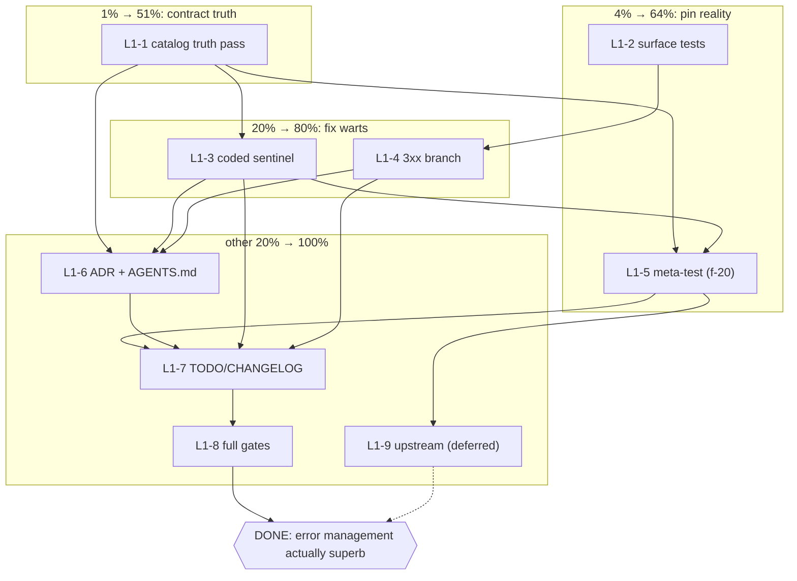

# Error Management → Actually Superb (Pareto Execution Plan)

- **Date:** 2026-10-27 18:35
- **Trigger:** "You sure our error management is superb?!?" → brutal review found
  2 contract breaks + 3 gaps: [`docs/reviews/2026-10-27_17-58_brutal-self-review.html`](../reviews/2026-10-27_17-58_brutal-self-review.html)
- **Goal:** close all 5 verified findings without breaking the bank-sync drop-in
  contract, the ADR 0002 error model, or any green gate.
- **Non-goal (explicit):** no public-API signature changes (`error` returns are
  the SDK contract), no error-model rewrite, no new dependencies.

## Verified findings (all re-checked against code today)

| #  | Finding                                                                                                                                                                                   | Evidence                                              |
| -- | ----------------------------------------------------------------------------------------------------------------------------------------------------------------------------------------- | ----------------------------------------------------- |
| F1 | Retry exhaustion surfaces `retry.exhausted`/Infrastructure; the `paperless.*` code and Transient family are buried in the cause chain — exactly when consumers need them (persistent 429) | `client.go:1790-1816`, go-retry v0.8.0 `retry.go:123` |
| F2 | ERROR_CODES.md header claims "Every error carries a `paperless.*` code" — false for bare `ErrInvalidConfig` and the three `retry.*` terminal outcomes; no reverse-direction gate exists   | `docs/ERROR_CODES.md:3`, `client.go:140,313`          |
| F3 | `request_failed` family drift: docs say Infrastructure, code says `WrapTransient` (code is load-bearing: default predicate retries Transient-only, and the row says "Retryable: yes")     | `docs/ERROR_CODES.md:38` vs `client.go:1863`          |
| F4 | 3xx responses fall into the 5xx default → `paperless.server_error`/Transient ("retry the redirect")                                                                                       | `client.go:2054-2072`                                 |
| F5 | Cancellation surfaces a different code depending on `WithRetry` (`paperless.request_failed` vs `retry.canceled`)                                                                          | `client.go:1861-1866` vs go-retry `retry.go:214-218`  |

Strengths that stay untouched (verified): classification at source, mechanical
catalog gate, structured context incl. `body_read_error`, tested Retry-After
bridging, byte-exact retry body replay, rejections-never-retried.

## Pareto breakdown

### The 1% that deliver 51% — make the consumer contract truthful

Pure documentation, zero code risk, immediately stops misleading every
consumer: fix F3's family cell, scope F2's header claim, add the Retry-outcomes
section documenting `retry.exhausted` / `retry.canceled` / `retry.deadline`
(code, family, reachability rules: `errors.Is`/`AsType` reach the paperless
cause; `Code()`/`Classify()` return the outermost `retry.*` classification).
**~40 min.**

### The 4% that deliver 64% — pin reality with tests (no behavior change)

Tests are the safety net that makes every later fix provably
non-verschlimmbesserung: exhaustion surface (429 × MaxAttempts →
`retry.exhausted` + cause reachable), cancel-without-retry, cancel-with-retry,
3xx current classification (pinned before it changes), and the TODO_LIST f-20
meta-test asserting every public-API error is coded (with the now-documented
carve-outs). **~90 min.**

### The 20% that deliver 80% — fix the two behavior warts

1. `classifyStatus` 3xx branch → new code `paperless.redirect` (family
   Rejection, `Location` header in context) + catalog row + table test (folds
   in the TODO_LIST classifyStatus-table-test row). **~45 min.**
2. Code the sentinel: `New` returns `errorfamily.WrapRejection(ErrInvalidConfig,
   "paperless.invalid_config", …)` — `errors.Is` keeps matching, family becomes
   Rejection, catalog moves it into the Validation table. **~30 min.**

### The other 20% (to reach 100%)

- ADR 0002 amendment (retry-outcome surface + coded-sentinel decisions) and
  AGENTS.md error-model bullet sync.
- TODO_LIST + CHANGELOG `[Unreleased]` bookkeeping (3xx reclassification and
  coded sentinel are behavior changes; they ride the pending v0.5.x release
  decision, TODO_LIST row 2).
- Upstream go-retry evaluation: option to surface the last attempt's code
  outermost on exhaustion (family stays Infrastructure for fail-closed
  nesting). Separate session; verify against go-retry source first.
- Full gate re-run: `nix fmt`, `nix run .#vet|#test`, both erraudit
  invocations, doc-drift test (new codes REQUIRE catalog rows or
  `TestErrorCodesAreDocumented` fails — that is the intended enforcement).

## Level 1 — medium granularity (30–100 min each)

Sorted by importance / impact / effort / customer-value.

| #    | Task                                                                                                                | Tier | Customer value                             | Impact | Effort  | Depends on |
| ---- | ------------------------------------------------------------------------------------------------------------------- | ---- | ------------------------------------------ | ------ | ------- | ---------- |
| L1-1 | Catalog truth pass: fix `request_failed` row, scope header claim, add Retry-outcomes section                        | 1%   | Consumers can trust the contract again     | High   | 40 min  | —          |
| L1-2 | Pin current surfaces with tests: exhaustion, cancel×2, 3xx-as-is                                                    | 4%   | Regression safety net for everything after | High   | 90 min  | —          |
| L1-3 | Code the sentinel (`paperless.invalid_config`) + tests + catalog move                                               | 20%  | Config errors become family-classifiable   | Medium | 30 min  | L1-1       |
| L1-4 | `classifyStatus` 3xx branch (`paperless.redirect`) + table test + catalog row                                       | 20%  | Redirects stop being retried               | Medium | 45 min  | L1-2       |
| L1-5 | Meta-test: every public-API error carries a non-empty code (supersedes TODO_LIST f-20; carve-outs empty after L1-3) | 4%   | The header claim becomes mechanically true | High   | 45 min  | L1-1, L1-3 |
| L1-6 | ADR 0002 amendment + AGENTS.md error-model sync                                                                     | rest | Decisions stay discoverable                | Medium | 40 min  | L1-1..L1-4 |
| L1-7 | TODO_LIST + CHANGELOG `[Unreleased]` bookkeeping                                                                    | rest | Honest living docs                         | Medium | 30 min  | L1-1..L1-5 |
| L1-8 | Full gate re-run (fmt, vet, test, both erraudit modes, flake check)                                                 | rest | Provably no worse than found               | High   | 30 min  | all        |
| L1-9 | Upstream go-retry exhaustion-code evaluation (verify-then-file; separate session)                                   | rest | F1 fixed at the root                       | Medium | 100 min | L1-5       |

Total ≈ 7.5 h of executable work (L1-9 optional/deferred).

## Level 2 — fine granularity (≤ 12 min each)

Sorted by importance / impact / effort / customer-value within execution order.

| #     | Task                                                                                    | Parent | Est    | Verification                   |
| ----- | --------------------------------------------------------------------------------------- | ------ | ------ | ------------------------------ |
| L2-01 | Fix `request_failed` family cell → Transient in ERROR_CODES.md                          | L1-1   | 3 min  | row matches `client.go:1863`   |
| L2-02 | Rewrite header claim: scope to coded errors + point at Retry outcomes                   | L1-1   | 6 min  | sentence provably true         |
| L2-03 | Draft Retry-outcomes section: exhausted/canceled/deadline (code, family, reachability)  | L1-1   | 10 min | matches go-retry v0.8.0 source |
| L2-04 | Add sentinel caveat ("no code by design" → until L1-3) + cross-links                    | L1-1   | 5 min  | no overclaim left              |
| L2-05 | Test skeleton: 429 server, `WithRetry(MaxAttempts:3)` Upload                            | L1-2   | 10 min | compiles                       |
| L2-06 | Assert exhaustion: `Code=retry.exhausted`, `Classify=Infrastructure`                    | L1-2   | 8 min  | test green                     |
| L2-07 | Assert cause reachability: `errors.AsType[*RetryAfterError]` + inner code               | L1-2   | 10 min | test green                     |
| L2-08 | Test: cancel without retry → `request_failed`/Transient + `errors.Is(context.Canceled)` | L1-2   | 10 min | test green                     |
| L2-09 | Test: cancel with retry during backoff → `retry.canceled`/Infrastructure                | L1-2   | 12 min | test green                     |
| L2-10 | Test: pin 3xx → `server_error`/Transient (marked pre-fix expectation)                   | L1-2   | 8 min  | test green                     |
| L2-11 | Wrap `ErrInvalidConfig` with `paperless.invalid_config` (Rejection) in `New`            | L1-3   | 8 min  | `errors.Is` still matches      |
| L2-12 | Test: `New("")` → code `paperless.invalid_config`, family Rejection, sentinel matchable | L1-3   | 8 min  | test green                     |
| L2-13 | Catalog: move sentinel into Validation table, drop the caveat from L2-04                | L1-3   | 6 min  | drift test green               |
| L2-14 | Implement 3xx branch in `classifyStatus` (+`Location` context)                          | L1-4   | 10 min | no other branch touched        |
| L2-15 | Flip L2-10 expectation → `paperless.redirect`/Rejection                                 | L1-4   | 5 min  | test green                     |
| L2-16 | Extend `classifyStatus` table test (401/403/429/4xx/5xx/3xx matrix)                     | L1-4   | 12 min | test green                     |
| L2-17 | Catalog row for `paperless.redirect`                                                    | L1-4   | 4 min  | drift test green               |
| L2-18 | Meta-test: enumerate public API error paths → non-empty `Code`, zero carve-outs         | L1-5   | 12 min | test green                     |
| L2-19 | ADR 0002: add Retry-outcome surface + coded-sentinel decisions                          | L1-6   | 12 min | status stays accepted          |
| L2-20 | AGENTS.md: sync error-model bullet (retry.* surface, redirect code)                     | L1-6   | 6 min  | no contradiction               |
| L2-21 | CHANGELOG `[Unreleased]`: 3xx reclassification + coded sentinel entries                 | L1-7   | 6 min  | version contract intact        |
| L2-22 | TODO_LIST: add umbrella row pointing here; annotate f-20 supersession                   | L1-7   | 6 min  | HARVEST-compatible             |
| L2-23 | Gates: `nix fmt` + `nix run .#vet` + `nix run .#test`                                   | L1-8   | 12 min | all green                      |
| L2-24 | Gates: both erraudit invocations (blessed + `--max --disable generic_return`)           | L1-8   | 4 min  | exit 0 ×2                      |
| L2-25 | Gates: `nix flake check`                                                                | L1-8   | 10 min | green                          |
| L2-26 | Read go-retry README/issues for an existing exhaustion-code proposal                    | L1-9   | 10 min | no duplicate filing            |
| L2-27 | Draft upstream proposal (keep inner code outermost, family stays Infrastructure)        | L1-9   | 12 min | verify-before-filing skill     |

## Execution graph

## Guardrails (no verschlimmbesserung)

1. **Tests before behavior changes** — L1-2 pins every surface L1-4 touches.
2. **No public signatures change** — `error` returns stay (ADR 0002); new codes
   are contract-legal additions; existing codes never change meaning.
3. **The drift test is the enforcement** — any new `paperless.*` code without a
   catalog row fails `TestErrorCodesAreDocumented`; do not weaken that test.
4. **`errors.Is(err, ErrInvalidConfig)` must keep matching** — asserted by
   L2-12 before L1-3 is considered done.
5. **No release in this plan** — behavior changes land under `[Unreleased]` and
   ride the pending v0.5.x tagging decision (owner, TODO_LIST row 2).
6. **Each L1 task ends green** — fmt + vet + test + both erraudit modes before
   moving on.

## Errata (backlog corrections)

- TODO_LIST f-20 ("meta-test asserting every error carries a non-empty code")
  is **unsatisfiable as specced today**: F2 proves the claim false (bare
  sentinel, `retry.*` outcomes). L1-3 + L1-5 make it true and then pin it;
  the row's premise is superseded by this plan.
- TODO_LIST "classifyStatus table test" (Test tail row) is absorbed into
  L1-4 / L2-16 rather than staying a separate backlog item.

## Verification gates (final)

- [ ] `nix run .#test` green, including new surface tests + meta-test
- [ ] `nix fmt` clean, `nix run .#vet` green, `nix flake check` green
- [ ] Blessed erraudit exit 0; `--max --disable generic_return` exit 0
- [ ] ERROR_CODES.md contains zero provably-false sentences
- [ ] `errors.Is(err, ErrInvalidConfig)` still matches through the coded wrap
