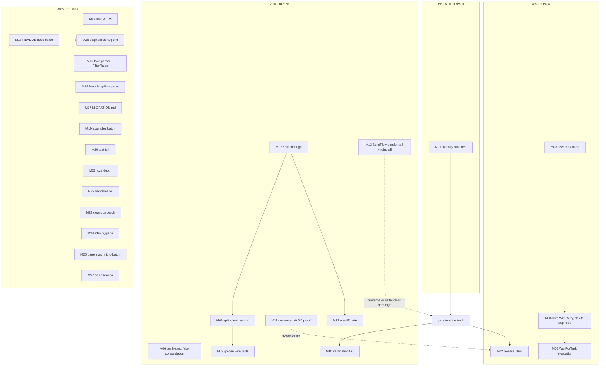

# Pareto Execution Plan — go-paperless backlog, fully decomposed

**Created:** 2026-11-07 20:07 CET · **Lineage:** papersync scope review + vendor-drift
repair session (see `docs/status/2026-11-07_19-59_papersync-scope-review-and-vendor-repair.md`)

**Scope line — verified:** every task below was re-verified open against the living
backlog this session (`TODO_LIST.md` read in full, 24 rows; ROADMAP raw ideas read;
CHANGELOG `[Unreleased]`/`[0.5.0]` checked; session findings re-checked against code:
flake reproduced+isolated 10/10-solo, consumers' go.mod pins read, InboxClean wiring
grepped). **Not verified:** task effort estimates are judgment, not measurement; the
two owner-blocked rows (billing, erraudit proxy) could not be probed from here.

**Errata vs. stale backlog (corrections already applied):** TODO row 25 rewritten this
session (consumers pin v0.5.0, not v0.4.x — migration DONE, fake consolidation
remains); row 24's "consumers must migrate first" blocker is resolved — only the
ritual + owner decision remain; the 2026-10-11 "test tail" row already lost its
classifyStatus half (landed 2026-10-27).

**Result definition (what "100%" means):** a trustworthy, shipping SDK whose gate tells
the truth, whose compatibility contract is mechanically protected, whose consumers run
verified on current pins, and whose docs/tests/infra debt is either paid or explicitly
parked with a trigger.

---

## 1. Pareto breakdown

| Tier           | Share of work       | Cumulative result | Items (backlog ids)                                                                                                                                                                                                                                                                                                                                                                                                                                                                                                            |
| -------------- | ------------------- | ----------------- | ------------------------------------------------------------------------------------------------------------------------------------------------------------------------------------------------------------------------------------------------------------------------------------------------------------------------------------------------------------------------------------------------------------------------------------------------------------------------------------------------------------------------------ |
| **1%**         | 1 task              | **51%**           | **S1: fix `TestWithRetryCancelDuringBackoffSurfacesRetryCanceled`** — the gate's truth underpins every other claim; this very session tripped over it (red under load, green solo). One deterministic fix restores CI signal for ALL future work                                                                                                                                                                                                                                                                               |
| **4%**         | +2 tasks (3 total)  | **64%**           | **S4: WithRetry adoption fleet-wide** (audit S3 → wire 3 InboxClean sites → delete papersync's weaker hand-rolled retry → WaitForTask evaluation) — removes a duplicated retry brain, the real reliability win. **T2: release ritual** — closes the three-place version contract both consumers already live on                                                                                                                                                                                                                |
| **20%**        | +7 tasks (10 total) | **80%**           | **T3** bank-sync fake consolidation (split-brain kill) · **T6** client.go/client_test.go split (core-artifact maintainability) · **T7** golden wire-shape tests (contract, mechanically pinned) · **T5** 2026-10-11 verification-tail closure (35-min standing High row) · **S5** InboxClean v0.5.0 build+test proof (inference → measurement) · **T9** api-diff gate (protects the bank-sync drop-in contract) · **S11+S12** BuildFlow binary reinstall + vendor-tail upstream (kills the 97340ef-class breakage at the root) |
| **80% (rest)** | remaining tasks     | **100%**          | Docs (MIGRATION.md, README, CONTRIBUTING, examples), fake design (2 ADRs, parser consolidation), CI gates (branching-flow probe, strong-id), test depth (test tail, fuzz, benchmarks, cleanups batch), infra hygiene (erraudit pin, pins/indirects audit, LSP diagnosis, live-server cadence), papersync micro-batch, parked/conditional items with triggers                                                                                                                                                                   |

### Parked / conditional (NOT scheduled — trigger-gated, kept visible so "ALL TODOs" are accounted for)

| Item                                                                                                   | Trigger to activate                                                                  |
| ------------------------------------------------------------------------------------------------------ | ------------------------------------------------------------------------------------ |
| pdfdecrypt sibling-package extraction (+ `/Encrypt` fixture carry-over)                                | bank-sync or any 2nd consumer needs encrypted-PDF ingestion                          |
| branching-flow v2 typed-API revisit (brand string params, struct unification, drop scaffolding)        | v2 migration window opens AND branching-flow ships dupe/composition line-suppression |
| gosec CI scan restore                                                                                  | gosec ships go1.27-capable release (verify locally per AGENTS.md recipe)             |
| govalid unskip                                                                                         | govalid adopted OR machine rebuilds on Go ≥ 1.27                                     |
| erraudit CI job                                                                                        | erraudit on public module proxy (re-verify 404 first)                                |
| Restore consumer CI (billing)                                                                          | owner fixes GitHub billing — owner action, not schedulable                           |
| Streaming upload design doc                                                                            | ADR 0003 demand gate opens                                                           |
| WaitForTask jitter / shared rate-limit backoff / per-call retry override; capabilities-informed tuning | 429-storm or fleet-sync pain observed                                                |
| Typed public STRING fields                                                                             | v2 breaking window                                                                   |
| Saved-view Update/Retrieve; share-link conveniences; ProbeCapabilities caching                         | consumer demand signal                                                               |
| MIGRATION.md demand re-check                                                                           | next consumer pin bump                                                               |

---

## 2. Comprehensive plan — 27 tasks, 30–100 min each, ALL todos included, sorted by impact/effort/customer-value

| #   | Task                                                                                                                                                                                                     | Covers backlog    | Tier | Est.              |
| --- | -------------------------------------------------------------------------------------------------------------------------------------------------------------------------------------------------------- | ----------------- | ---- | ----------------- |
| M01 | Fix the load-sensitive flake: make cancellation-vs-backoff deterministic in `TestWithRetryCancelDuringBackoffSurfacesRetryCanceled`, soak `-race -count=50`                                              | S1                | 1%   | 90 min            |
| M02 | Release ritual: decide v0.5.1-cut vs tag-now, run `nix run .#release-verify -- vX.Y.Z`, close TODO row 24                                                                                                | T2                | 4%   | 60 min            |
| M03 | Fleet retry audit: map bank-sync + InboxClean hand-rolled retry/poll duplication against SDK `WithRetry`/`WaitForTask`                                                                                   | S3                | 4%   | 45 min            |
| M04 | Wire `WithRetry` into InboxClean's 3 `paperless.New` sites, delete papersync `uploadWithRetry`, adapt its tests (decide backoff values)                                                                  | S4                | 4%   | 90 min            |
| M05 | Evaluate papersync `resolveTaskOutcome` → `WaitForTask` + per-upload deadline ctx (keep non-blocking run shape, or document rejection)                                                                   | S4b               | 4%   | 45 min            |
| M06 | bank-sync: replace `testhelpers.NewFakePaperlessServer` with `paperlesstest`, delete hand-rolled fake                                                                                                    | T3                | 20%  | 90 min            |
| M07 | Split `client.go` by domain — same package, mechanical: upload/tasks/documents/named/notes/sharelinks/savedviews/transport                                                                               | T6a               | 20%  | 100 min           |
| M08 | Split `client_test.go` by domain to match M07 layout                                                                                                                                                     | T6b               | 20%  | 100 min           |
| M09 | Golden-bytes wire-shape tests: `"id":null` create bodies, `"correspondent":null`, FK-clearing null-PATCH, saved-view `"filter_rules":[]`                                                                 | T7                | 20%  | 60 min            |
| M10 | Close 2026-10-11 verification tail: negative-verify drift guard, `pageBounds` overflow regression test, 30s fuzz smoke, coverage vs ~88.6%                                                               | T5                | 20%  | 40 min            |
| M11 | InboxClean v0.5.0 proof: build + full test suite on the pinned version, record evidence in TODO row                                                                                                      | S5                | 20%  | 45 min            |
| M12 | api-diff gate: pick tooling, baseline current public API, wire into CI so accidental contract breaks fail the build                                                                                      | T9                | 20%  | 90 min            |
| M13 | BuildFlow root-fix: upstream a vendor-tail step (go.mod change → `go mod vendor` + `nix-hash-fix`), reinstall local binary (e35e902 → HEAD)                                                              | S12+S11           | 20%  | 60 min + upstream |
| M14 | Write the two fake ADRs: pagination policy + store==serve entity-family convention                                                                                                                       | T11               | rest | 60 min            |
| M15 | Consolidate fake's `parseServedCreated`/`parseUploadDate`; decide + test nil-vs-empty `FilterRules`                                                                                                      | T12               | rest | 40 min            |
| M16 | branching-flow gates: probe `--exit-code` semantics, wire 0-active gate + `strong-id --exit-code` into CI                                                                                                | T10+T13           | rest | 90 min            |
| M17 | Write MIGRATION.md for v0.4→v0.5 consumers (branded-ID idioms, `.Get()` vs `%v`, two wire deltas)                                                                                                        | T14               | rest | 60 min            |
| M18 | Docs batch: README download/update common-tasks snippets + `WithRetry`/`WaitForTask` documentation + review-series links                                                                                 | T16+S17           | rest | 60 min            |
| M19 | Runnable examples: `UpdateDocument`/`ListDocumentMetas`/`EnsureStoragePath`, download/update, hooks                                                                                                      | T18               | rest | 60 min            |
| M20 | Test tail: `GetTask`/`classifyTask` edge mix, hook-failure branches, multipart entry branches                                                                                                            | T17               | rest | 90 min            |
| M21 | Fuzz depth: `Retry-After` overflow seeds, real response-shape seeds, overnight budget recipe, CI crash-corpus upload                                                                                     | T20               | rest | 90 min            |
| M22 | Benchmarks: `BenchmarkEnsureTag` + branded hot-path benchmarks + periodic-run recipe                                                                                                                     | T19               | rest | 60 min            |
| M23 | Small cleanups batch: `tbStub` Fatalf, dead returns, `Requests()` Header clone, fold `newTestClientWithToken`, options-table drift test, apiVersion header test, family-label test, code-uniqueness test | T21               | rest | 90 min            |
| M24 | Infra hygiene: pin erraudit hermetically in flake; verify govulncheck v1.8.0 pin; lychee re-run over HTML reports; go.mod indirects audit                                                                | T8+T22            | rest | 60 min            |
| M25 | papersync micro-batch (InboxClean): `lastDotSegment`→`path.Ext`, MIME-fallback determinism decision, `encryptedTagName` config decision, verify 128-char title cap vs server, `/Encrypt` fixture note    | S8+S9+S13+S14+S18 | rest | 60 min            |
| M26 | Diagnostics hygiene: golangci-LSP stale-vendor-error diagnosis, consumers-pin line in TODO row template, README WithRetry drift test                                                                     | S10+S19+S50       | rest | 45 min            |
| M27 | Ops cadence: papersync fuzz targets on InboxClean CI schedule; periodic live-server integration runs; re-verify parked triggers (erraudit proxy, gosec, govalid)                                         | S15+S16+parked    | rest | 60 min            |

**Coverage check:** TODO_LIST rows 23–24 (parked/owner + M02), 25 (M06), 26 (parked v2),
27 (M10), 28 (M07/M08), 29 (M09), 30 (M24), 31 (M12), 32 (M16), 33 (M14), 34 (M15),
35 (M16-half), 36 (M17), 37 (M27 CONTRIBUTING half → folded into M27/M18? — CONTRIBUTING
flake-apps naming is its own 20-min row → absorbed into M18 docs batch),
38 (M19), 39 (M22), 40 (M21), 41 (M23), 42 (M24), 43/44 (parked) — plus all 17
session findings and ROADMAP gated ideas above. **Nothing dropped.**

---

## 3. Fine breakdown — ≤12 min subtasks, ALL todos, sorted (parent order = global priority; subtasks inherit)

| Id    | Subtask (≤12 min)                                                                                                                   | Parent | Min |
| ----- | ----------------------------------------------------------------------------------------------------------------------------------- | ------ | --- |
| F0101 | Read the flaky test + its go-retry v0.9.0 interaction; write down the two orderings that produce `rate_limited` vs `request_failed` | M01    | 12  |
| F0102 | Choose determinism mechanism: injectable clock vs synchronized cancel-before-attempt hook                                           | M01    | 10  |
| F0103 | Implement the fix                                                                                                                   | M01    | 12  |
| F0104 | Soak: `go test -race -run TestWithRetryCancelDuringBackoffSurfacesRetryCanceled -count=50`                                          | M01    | 12  |
| F0105 | Full `-race` suite once + `nix run .#check` green                                                                                   | M01    | 12  |
| F0106 | Annotate TODO/AGENTS if the flake class has siblings (search `CancelDuring`/timing-dependent tests)                                 | M01    | 8   |
| F0201 | Read `[Unreleased]` vs `[0.5.0]` deltas; list what a v0.5.1 would carry                                                             | M02    | 12  |
| F0202 | Owner-decision capture: tag-now vs v0.5.1-cut (question to Lars, don't guess)                                                       | M02    | 5   |
| F0203 | Bump flake `version` + CHANGELOG heading if cutting vX.Y.Z                                                                          | M02    | 10  |
| F0204 | `nix run .#release-verify -- vX.Y.Z` — fix any drift it reports                                                                     | M02    | 12  |
| F0205 | Tag, push, verify pkg.go.dev + proxy propagation                                                                                    | M02    | 12  |
| F0206 | Close TODO row 24, log release in CHANGELOG                                                                                         | M02    | 5   |
| F0301 | Grep bank-sync for retry/sleep/poll loops around paperless calls                                                                    | M03    | 12  |
| F0302 | Grep InboxClean for same (uploadWithRetry, resolveTaskOutcome usage sites)                                                          | M03    | 10  |
| F0303 | Write the duplication map: who retries what, with which values                                                                      | M03    | 12  |
| F0401 | Decide RetryPolicy values (attempts/delays) replacing papersync's 500ms-base scheme                                                 | M04    | 10  |
| F0402 | Wire `WithRetry` at main.go:609                                                                                                     | M04    | 8   |
| F0403 | Wire `WithRetry` at doctor_command.go:541 and paperless_command.go:318                                                              | M04    | 8   |
| F0404 | Delete papersync `uploadWithRetry`/`uploadAttempts`/`retryBackoff`; call `Upload` directly                                          | M04    | 12  |
| F0405 | Adapt papersync tests that exercised the retry loop (retryafter usage drops out)                                                    | M04    | 12  |
| F0406 | Run InboxClean papersync test suite green                                                                                           | M04    | 10  |
| F0407 | Record decision + evidence in InboxClean AGENTS/TODO                                                                                | M04    | 8   |
| F0501 | Prototype `WaitForTask`-based poll with per-upload `context.WithTimeout` in a branch                                                | M05    | 12  |
| F0502 | Compare semantics: not-found handling, attempt budget equivalence, ledger recording points                                          | M05    | 12  |
| F0503 | Decide adopt/reject; if adopt, port + tests; if reject, write rationale comment                                                     | M05    | 12  |
| F0601 | Read bank-sync `internal/testhelpers/fakes.go` surface vs `paperlesstest` API                                                       | M06    | 12  |
| F0602 | Map each fake behavior to paperlesstest equivalent (or gap-list)                                                                    | M06    | 12  |
| F0603 | Swap construction sites in bank-sync tests (batch 1)                                                                                | M06    | 12  |
| F0604 | Swap remaining sites (batch 2)                                                                                                      | M06    | 12  |
| F0605 | Delete `fakes.go`; run bank-sync suite green                                                                                        | M06    | 10  |
| F0606 | Update TODO row 25 → DONE evidence; CHANGELOG (consumer work → status report pointer)                                               | M06    | 5   |
| F0701 | Choose file layout + write the domain-to-file mapping comment block                                                                 | M07    | 10  |
| F0702 | Move upload/tasks block (Upload, writeUploadMetadata, writeCustomFieldsField, task types)                                           | M07    | 12  |
| F0703 | Move documents block (list/meta/update/delete/download/checksums)                                                                   | M07    | 12  |
| F0704 | Move named-entity block (generic helpers, Ensure*, storage paths)                                                                   | M07    | 12  |
| F0705 | Move notes + sharelinks + savedviews blocks                                                                                         | M07    | 12  |
| F0706 | Move transport block (doRequest/doRequestDetail/classifyStatus/RetryAfter/probes)                                                   | M07    | 12  |
| F0707 | `nix run .#check` green; confirm zero content edits (move-only diff)                                                                | M07    | 10  |
| F0801 | Split client_test.go: upload/tasks + documents test files                                                                           | M08    | 12  |
| F0802 | Split: named + notes tests                                                                                                          | M08    | 12  |
| F0803 | Split: sharelinks + savedviews + transport tests                                                                                    | M08    | 12  |
| F0804 | Split: retry/poll + fuzz-support fixtures; full gate green                                                                          | M08    | 12  |
| F0901 | Golden test helper: request-snapshot capture of outgoing multipart/PATCH bytes                                                      | M09    | 12  |
| F0902 | Golden: upload create body (`"id":null`, `"correspondent":null` variants)                                                           | M09    | 12  |
| F0903 | Golden: FK-clearing null-PATCH body                                                                                                 | M09    | 10  |
| F0904 | Golden: saved-view create `"filter_rules":[]` answer                                                                                | M09    | 10  |
| F0905 | Wire goldens into drift protection (fail on wire-shape change)                                                                      | M09    | 12  |
| F1001 | Negative-verify drift guard: temp unknown `findByName` kind → red → revert                                                          | M10    | 10  |
| F1002 | `pageBounds` overflow regression test                                                                                               | M10    | 10  |
| F1003 | `nix run .#fuzz -- 30s` smoke                                                                                                       | M10    | 10  |
| F1004 | `nix run .#coverage` vs ~88.6% baseline; record delta                                                                               | M10    | 10  |
| F1101 | InboxClean: `nix build` + full test suite on v0.5.0 pin                                                                             | M11    | 12  |
| F1102 | bank-sync: same proof run                                                                                                           | M11    | 12  |
| F1103 | Record results as TODO/AGENTS evidence lines                                                                                        | M11    | 8   |
| F1201 | Pick api-diff tooling (gorelease vs apidiff vs custom go/types walker)                                                              | M12    | 12  |
| F1202 | Baseline current public API into a committed manifest                                                                               | M12    | 12  |
| F1203 | CI step: diff vs baseline, fail on breaking change                                                                                  | M12    | 12  |
| F1204 | Docs: how to re-baseline intentionally (release flow)                                                                               | M12    | 8   |
| F1301 | Write the BuildFlow vendor-tail step proposal (detect go.mod/go.sum change → run vendor + hash-fix)                                 | M13    | 12  |
| F1302 | Implement/propose upstream (issue or PR per verify-before-filing)                                                                   | M13    | 12  |
| F1303 | `nix build . && nix run .#reinstall` local binary; confirm advisory warn gone                                                       | M13    | 10  |
| F1401 | ADR: fake pagination policy (page 100, cap 100, short-page stop)                                                                    | M14    | 12  |
| F1402 | ADR: store==serve entity-family convention (why notes/uploads split)                                                                | M14    | 12  |
| F1403 | Link both from paperlesstest doc comments + docs/adr index                                                                          | M14    | 8   |
| F1501 | Merge `parseServedCreated`/`parseUploadDate` into one parser                                                                        | M15    | 12  |
| F1502 | Decide nil-vs-empty `FilterRules`; write the contract test                                                                          | M15    | 12  |
| F1503 | Run paperlesstest suite green                                                                                                       | M15    | 8   |
| F1601 | Probe `branching-flow --exit-code` semantics (README vs observed)                                                                   | M16    | 12  |
| F1602 | Wire 0-active findings gate (baseline/manifest form) into CI                                                                        | M16    | 12  |
| F1603 | Wire `strong-id --exit-code` gate                                                                                                   | M16    | 10  |
| F1604 | `nix flake check` integration check + docs note                                                                                     | M16    | 10  |
| F1701 | Draft MIGRATION.md structure (idioms, `.Get()` vs `%v`, wire deltas)                                                                | M17    | 12  |
| F1702 | Write branded-ID migration section with before/after snippets                                                                       | M17    | 12  |
| F1703 | Write the two wire deltas + verification steps; link from README                                                                    | M17    | 12  |
| F1801 | README: download/update common-tasks snippets                                                                                       | M18    | 12  |
| F1802 | README: `WithRetry` + `WaitForTask` usage section                                                                                   | M18    | 10  |
| F1803 | README: link review series (For Contributors) + CONTRIBUTING flake-apps naming                                                      | M18    | 12  |
| F1901 | Example: `UpdateDocument`                                                                                                           | M19    | 10  |
| F1902 | Example: `ListDocumentMetas`                                                                                                        | M19    | 8   |
| F1903 | Example: `EnsureStoragePath`                                                                                                        | M19    | 8   |
| F1904 | Example: download/update roundtrip + hooks in `ExampleNew_withOptions`                                                              | M19    | 12  |
| F2001 | `GetTask`/`classifyTask` edge-mix table test                                                                                        | M20    | 12  |
| F2002 | Hook-failure branch tests                                                                                                           | M20    | 12  |
| F2003 | Multipart entry branch tests                                                                                                        | M20    | 12  |
| F2004 | Run suite + coverage delta                                                                                                          | M20    | 8   |
| F2101 | Seed: `Retry-After` overflow edges into fuzz corpus                                                                                 | M21    | 10  |
| F2102 | Seeds: real response-shape captures per endpoint                                                                                    | M21    | 12  |
| F2103 | Overnight-budget fuzz recipe (flake app invocation doc)                                                                             | M21    | 10  |
| F2104 | CI: diagnosable fuzz failures (crash corpus upload artifact)                                                                        | M21    | 12  |
| F2201 | `BenchmarkEnsureTag`                                                                                                                | M22    | 12  |
| F2202 | Branded hot-path benchmarks (ID marshal/unmarshal)                                                                                  | M22    | 12  |
| F2203 | Periodic benchmark-run recipe + baseline recording                                                                                  | M22    | 10  |
| F2301 | Cleanups: `tbStub` Fatalf + dead returns after Fatal                                                                                | M23    | 10  |
| F2302 | `Requests()` deep-clone Header + fold `newTestClientWithToken`                                                                      | M23    | 12  |
| F2303 | Options-table drift test + apiVersion header test                                                                                   | M23    | 12  |
| F2304 | family-label + code-uniqueness tests                                                                                                | M23    | 12  |
| F2401 | Pin erraudit hermetically in flake (bank-sync recipe) + verify `which erraudit`                                                     | M24    | 12  |
| F2402 | Verify govulncheck CI pin v1.8.0 current                                                                                            | M24    | 8   |
| F2403 | Lychee re-run over 2026-10-11 HTML reports                                                                                          | M24    | 10  |
| F2404 | go.mod indirects audit                                                                                                              | M24    | 10  |
| F2501 | papersync: `lastDotSegment` → `path.Ext`                                                                                            | M25    | 8   |
| F2502 | papersync: extend curated MIME table OR document fallback nondeterminism                                                            | M25    | 12  |
| F2503 | papersync: `encryptedTagName` config-surface decision + implementation or rationale                                                 | M25    | 12  |
| F2504 | Verify 128-char title cap vs server behavior; note evidence                                                                         | M25    | 10  |
| F2505 | `/Encrypt` fixture list → pdfdecrypt extraction spec stub                                                                           | M25    | 8   |
| F2601 | Diagnose golangci-LSP stale vendor-error replay (repro + upstream report if real)                                                   | M26    | 12  |
| F2602 | TODO row template: add consumers-pin line                                                                                           | M26    | 8   |
| F2603 | README WithRetry/WaitForTask docs-drift test (pair with F1802)                                                                      | M26    | 10  |
| F2701 | InboxClean CI: schedule papersync fuzz targets                                                                                      | M27    | 12  |
| F2702 | go-paperless: periodic live-server integration run recipe (real-server tier)                                                        | M27    | 12  |
| F2703 | Re-verify parked triggers: erraudit proxy 404, gosec go1.27 release, govalid nixpkgs                                                | M27    | 12  |
| F2704 | Record cadence + owners in TODO_LIST notes                                                                                          | M27    | 8   |

**Fine-table coverage:** F-rows decompose every M-task; M-tasks cover every backlog
item; parked table accounts for the trigger-gated remainder. Total fine work ≈ 1,340
min ≈ 22 h across 27 tasks / 95 subtasks.

---

## 4. Execution graph

**Reading the graph:** M01 is the root — every green checkmark downstream inherits its
trustworthiness. M03→M04→M05 is the retry-adoption chain (audit before rewiring).
M07→M08→M09/M12 is the contract-hardening chain (stable layout before pinning and
gating). M13 feeds back into gate trust by killing the breakage class at its root.

---

## 5. After approval

Per the skill's full-execution mode: work M01 → M27 in order, `git status` + commit
after each M-task, `nix run .#check` before every commit, stop only for the owner
decisions flagged in M02/F0202. New findings discovered en route get added to
TODO_LIST (living source), not to this snapshot. `docs-health` → HARVEST owns pulling
this plan's deltas into TODO_LIST.md at session end.
